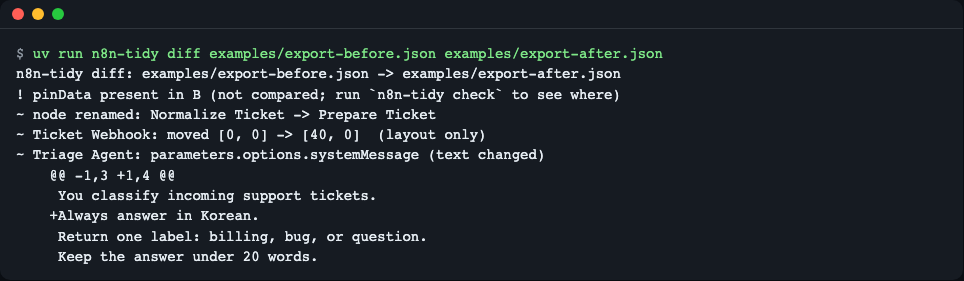
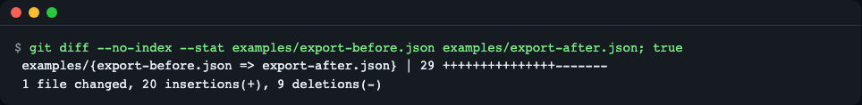
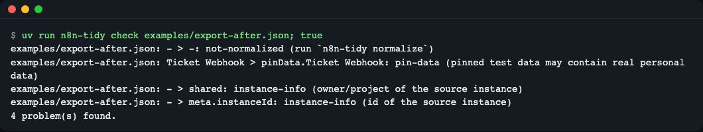
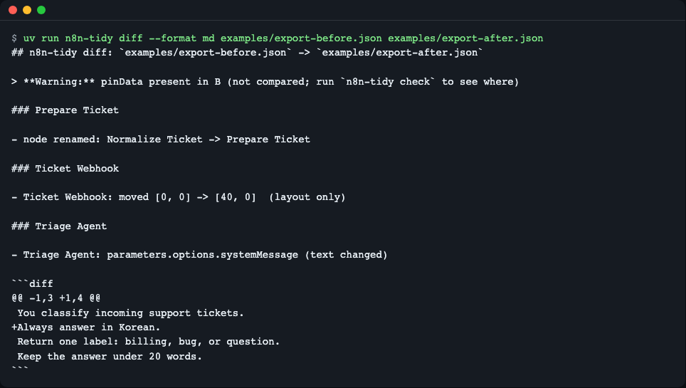
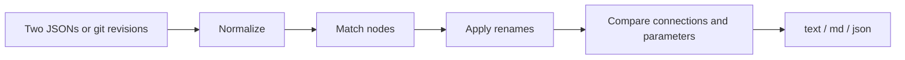

# n8n-tidy

[한국어](README.md) | **English**

`n8n-tidy` normalizes exported n8n workflow JSON, shows a semantic diff (renamed nodes, moved nodes, line-by-line AI prompt changes) and checks files before commit, without an n8n instance. It is for people who keep workflow exports in git. Install: `uv tool install git+https://github.com/LeeGyeongPil/n8n-tidy`, then `n8n-tidy diff A.json B.json`.

A small command-line tool that cleans up the noise that appears when you put n8n workflow JSON into git (`versionId` and `updatedAt` that change on every save, instance information, pinned test data) and the diff where "you changed one line of a prompt but the whole line shows as changed." It needs no n8n server and no network, and has no runtime dependencies (it uses only the Python standard library).


*A node rename, a position move, and one added prompt line each show up as a single line.*

Think of it as the n8n workflow version of `nbstripout`, which clears notebook outputs to keep diffs clean.

## Why it's needed — 3 kinds of noise in Community edition backups
1. **Fields that change on every save**: values such as `versionId` and `updatedAt` change regardless of content and get into every commit.
2. **Instance information and test data**: `shared`, `meta.instanceId`, and the `pinData` pinned from executions are included, so personal data can get mixed in.
3. **Hard-to-read changes**: renaming a node makes it look as if all the connections changed, and an AI prompt is a one-line string, so changing a single line makes the whole line show as changed.

## Who it's for
- People who self-host the n8n Community edition and back up the result of `n8n export:workflow --backup` with git
- Teams who want to review the prompts of AI Agent nodes in PRs
- People who must show customers the workflow change history, and who do not want to commit `pinData` (pinned test data) or a token by mistake

## Install
```bash
curl -LsSf https://astral.sh/uv/install.sh | sh   # If you don't have uv (Python 3.10 or later is required)
uv tool install git+https://github.com/LeeGyeongPil/n8n-tidy
n8n-tidy --version
```
```
n8n-tidy 0.1.3
```
To try it straight from source, run `git clone` and then `uv run n8n-tidy ...` inside the folder. (It has not been uploaded to PyPI yet.)

## Quick start
To run it once without installing, use `uvx` (available after the repository goes public. We ran the same approach from the source folder as `uvx --from . n8n-tidy --version` and confirmed `n8n-tidy 0.1.3`).
```bash
uvx --from git+https://github.com/LeeGyeongPil/n8n-tidy n8n-tidy diff A.json B.json
```

The repository's `examples/` holds two fake workflows (before and after editing). They are for practice and are not data taken from a real n8n. The example files exist only in the repository, so clone it first. The commands below run as they are, without an instance.
```bash
git clone https://github.com/LeeGyeongPil/n8n-tidy && cd n8n-tidy
n8n-tidy diff examples/export-before.json examples/export-after.json
```
```
n8n-tidy diff: examples/export-before.json -> examples/export-after.json
! pinData present in B (not compared; run `n8n-tidy check` to see where)
~ node renamed: Normalize Ticket -> Prepare Ticket
~ Ticket Webhook: moved [0, 0] -> [40, 0]  (layout only)
~ Triage Agent: parameters.options.systemMessage (text changed)
    @@ -1,3 +1,4 @@
     You classify incoming support tickets.
    +Always answer in Korean.
     Return one label: billing, bug, or question.
     Keep the answer under 20 words.
```
### How to read the semantic diff
- A `!` line is a warning. It means there is `pinData`, which is not compared.
- A `~` line is an actual change. A renamed node does not scatter into connection changes; it appears as a single "renamed" line.
- `(layout only)` marks that the node was only moved on the canvas (you can hide it with `--no-layout`).
- For prompts, only the changed lines are shown.
- For how nodes are matched and how renames are handled, see the "How it works" section below.

Here is how the same two files look with a plain `git diff`.


*Including the volatile fields, `shared`, and `pinData`, it shows 20 lines added and 9 deleted.*

## Usage
| Command / option | What it does | Example |
|---|---|---|
| `normalize PATH...` | Rewrites files or folders into a stable form (the same result however many times you run it) | `n8n-tidy normalize backups/` |
| `normalize --check` | Writes nothing, and exits with code 1 if cleanup is needed | `n8n-tidy normalize --check backups/` |
| `normalize --stdout` | Only prints the result (one file) | `n8n-tidy normalize --stdout a.json` |
| `normalize --keep-pin-data` / `--keep-static-data` | Keeps the `pinData` and `staticData` that are removed by default | |
| `diff A B` | Semantic diff of two files | `n8n-tidy diff old.json new.json` |
| `diff PATH --rev REV` | Compares the file at a git revision with the working folder | `n8n-tidy diff flow.json --rev HEAD~1` |
| `diff --format text\|md\|json` | Output format (`md` is for PR comments) | `--format md` |
| `diff --exit-code` / `--no-layout` / `--color auto|always|never` | Exit code 1 on changes / hide position changes / whether to use color (value required) | |
| `show FILE` | A review view as per-node blocks | `n8n-tidy show flow.json` |
| `check PATH...` | Checks for `pinData`, not normalized, instance information, and token-suspect strings | `n8n-tidy check backups/` |
| `check --allow KIND` | Ignore that kind (repeatable) | `--allow instance-info` |
| `check --keep-static-data` | Treats the `staticData` kept with `normalize --keep-static-data` as normal (use the same option as a pair on both commands) | `n8n-tidy check --keep-static-data backups/` |
| `install-git [--dry-run]` | Registers the git diff driver for this repository | `n8n-tidy install-git` |
| `uninstall-git` | Removes what `install-git` wrote | |

### Scenario 1 — Check before committing
```bash
n8n-tidy check examples/export-after.json
```
```
examples/export-after.json: - > -: not-normalized (run `n8n-tidy normalize`)
examples/export-after.json: Ticket Webhook > pinData.Ticket Webhook: pin-data (pinned test data may contain real personal data)
examples/export-after.json: - > shared: instance-info (owner/project of the source instance)
examples/export-after.json: - > meta.instanceId: instance-info (id of the source instance)
4 problem(s) found.
```
If there are problems, the exit code is 1. After running `n8n-tidy normalize examples/export-after.json` and checking again, you get `ok: no problems found.`.


*Four problems and exit code 1.*

The `secret-suspect` check (strings that look like tokens) guesses with regular expressions, so it is no substitute for a dedicated secret scanner. For expression values that start with `=`, it checks what remains after removing the closed `{{ ... }}` spans, and an unclosed `{{` is checked as is. Even if the same token matches several patterns, it is reported once (a value like `Bearer sk-...` counts as 1 as well).

### Scenario 2 — Compare with the previous commit
```bash
n8n-tidy diff backups/ticket.json --rev HEAD
```
It compares the committed version with the file in the working folder and shows it in the same format as above. You must run it inside the repository.

### Scenario 3 — Make `git diff` easier to read
```bash
n8n-tidy install-git --dry-run
```
```
(dry run) .gitattributes: *.json diff=n8n
(dry run) git config --local diff.n8n.textconv 'n8n-tidy textconv'
(dry run) git config --local diff.n8n.cachetextconv 'true'
(dry run) git config --local difftool.n8n-tidy.cmd 'n8n-tidy diff "$LOCAL" "$REMOTE"'
```
Without `--dry-run`, it really writes. From then on, `git diff` converts the JSON into per-node blocks before comparing, so order-only changes are less visible and prompts show up line by line. With `git difftool -t n8n-tidy` you can also see the semantic diff above. Note, however, that the `git diff` (textconv) view lays nodes out in name order, so a renamed node looks like a deletion and an addition of blocks. For the one-line "renamed" summary, use `git difftool -t n8n-tidy` or `n8n-tidy diff --rev`. If `n8n-tidy` is not on PATH, textconv fails, so install it with `uv tool install`. The settings are written only to this repository's local git config and the global config is not touched. If the `*.json` pattern in `.gitattributes` is too broad, narrow it, for example `--pattern 'workflows/*.json'`. Files that are not workflows, or broken JSON, are shown as the original text, so git does not fail.

### Scenario 4 — Markdown for PR comments
```bash
n8n-tidy diff --format md examples/export-before.json examples/export-after.json
```
You get a `###` section per node and a ```` ```diff ```` block for prompts.


*A format you can paste into a PR body or comment.*

### Connecting to pre-commit
Add this to `.pre-commit-config.yaml` (we have not yet run this setting ourselves to confirm. The hook definition is the repository's `.pre-commit-hooks.yaml`).
```yaml
repos:
  - repo: https://github.com/LeeGyeongPil/n8n-tidy
    rev: v0.1.3
    hooks:
      - id: n8n-tidy-check
```
The `n8n-tidy-normalize` hook rewrites files directly. If you give the normalize hook `args: [--keep-static-data]`, give the check hook the same args.

### Putting it into GitHub Actions
This is an example that checks in a PR and leaves a change summary on the Actions summary screen. Without `fetch-depth: 0`, it cannot find a revision such as `origin/main`. This tool does not post comments, so connect that yourself if you need it.
```yaml
# .github/workflows/n8n-tidy.yml
name: n8n-tidy
on: pull_request
jobs:
  review:
    runs-on: ubuntu-latest
    steps:
      - uses: actions/checkout@v4
        with:
          fetch-depth: 0
      - uses: astral-sh/setup-uv@v6
      - run: uv tool install git+https://github.com/LeeGyeongPil/n8n-tidy
      - run: n8n-tidy check workflows/
      - run: n8n-tidy diff --rev origin/main workflows/x.json --format md >> "$GITHUB_STEP_SUMMARY"
```
`check` exits with code 1 when there are problems, so the job fails. To fail when there are changes, add `--exit-code` to `diff`. We could not run this YAML in real Actions. Instead, we ran the same commands in a temporary repository (`check workflows/` → exit 0, `diff --rev HEAD ... --format md >> file` → exit 0, `--exit-code` → exit 1) and confirmed them. Only `--rev` was changed to `HEAD`.

## Normalization rules
`normalize` **rewrites files in place.** Before running it on a whole folder, check first with `--check` or `--stdout`. Keys are sorted, indented by 2 spaces, and unified with a single newline at the end.

| Field | Handling | Reason | Related option |
|---|---|---|---|
| `updatedAt`, `createdAt`, `versionId`, `activeVersionId`, `versionCounter`, `versionMetadata`, `activeVersion`, `checksum`, `triggerCount`, `isArchived` | Always removed | Change on every save or import and are unrelated to logic | |
| `shared`, `homeProject`, `parentFolder`, `parentFolderId`, `scopes`, `usedCredentials`, `sharedWithProjects` | Always removed | Owner, project, and permission information of the source instance | |
| `meta.instanceId` | Always removed (if `meta` becomes empty, `meta` is removed too) | Identifier of the source instance | |
| `description`, `nodeGroups`, `sourceWorkflowId` | Removed only when empty | Fields added by newer n8n, removed to match older exports | |
| `pinData` | Removed by default | Pinned test data may contain personal data | `--keep-pin-data` |
| `staticData` | Removed by default | State values that accumulate during execution | `--keep-static-data` (the same option on `check`) |
| `tags[].createdAt`, `tags[].updatedAt` | Removed | Volatile timestamps | |
| Order of `nodes` and `tags` | Sorted by name | Eliminates order-only changes | |

What is kept: the workflow `id` (needed when re-importing), node `position`, `credentials` references, array order inside `connections`, and unknown top-level fields not listed above. Secret values of credentials are not in the export to begin with.

Difference from `n8nc fmt`: `fmt` keeps only 7 top-level keys (checked 2026-11-10), whereas `n8n-tidy` removes only the fields in the table above and leaves unknown fields alone. For fields from newer n8n versions, edit the one table at the top of `src/n8n_tidy/normalize.py`.

A `.json` file that is not UTF-8 is skipped without an error and reported as `skipped`.

## Settings
There are no config files or environment variables. For default behavior, see the "Normalization rules" table above.

### Mock mode and real mode
- **Practice mock mode**: this is not a mode you turn on separately. The tool only reads files, so it always behaves the same way, and the example JSON (`examples/`) is made-up values written by hand. All the commands above work this way.
- **Real mode**: `scripts/real-mode.sh` checks the same premises against files exported from a real n8n using the docker image `n8nio/n8n`. Downloading the image can take a few minutes the first time, and it is not run in the default CI. It needs docker and the network.
```bash
scripts/real-mode.sh
```
The shape of the expected output (hash values differ on every run; the following describes the format):
- The `normalized sha256:` values of `e1`, `e2`, and `e3` must be the same on all three lines. This means that even if you re-export or re-import the same workflow, it becomes the same bytes once normalized.
- `e4` is a file exported after importing the modified one, so it must differ from the values above.
- Under the final `--- diff e1 -> e4`, semantic change lines starting with `~` appear (a node rename, an added system prompt line, and so on).

## How it works

- **Normalize**: removes the fields that change on every save and the instance information, and fixes the key order.
- **Match nodes**: first pairs nodes by node `id`, and if there is no id, pairs them by name and type.
- **Apply renames**: in n8n, connections are written by node name, so when a name changes it looks as if all the connections changed. The name mapping table from the matching result is applied to the old connections before comparing, which removes this false change.
- **Compare**: collects only the connection and parameter differences, and shows long strings as a line-by-line diff.

## Comparison with other tools
Checked 2026-11-10 (based on public information from GitHub and PyPI).

| | n8n-tidy | n8n official source control | n8nc |
|---|---|---|---|
| Normalization (removing volatile fields) | Yes | Handled inside the app | Done well by `fmt` |
| Inline secret check | Regex guess (`check`) | Not applicable | Checked by `validate` |
| Comparing any two files or two git revisions | Yes | In the app after connecting git | Against the baseline snapshot or the instance of a repository set up with `n8nc init` |
| Line-by-line prompt diff, git textconv, pre-commit hook | Yes | Visual diff | None (within what we checked) |
| n8n instance integration (download and upload) | None | Yes | Yes |
| Requirements | Only files needed | Paid-plan feature | Install required (Rust binary) |

If you only need normalization, n8nc's `fmt` is also enough. If you want to sync with an instance as well, n8nc or the official feature is the right choice. This tool focuses on "reviewing and checking from files alone."

`n8n-workflows-comparator` is a tool that compares two backup files, but it has no volatile-field ignoring or git integration, and it has not been updated since 2025-05 (checked 2026-11-10).

## Limitations and next plans
- Arrays are compared by index, so deleting a node can show several `[i]` path changes.
- The token check is a regex heuristic.
- If one file holds several workflows, the pairing can go out of alignment.
- Next plans: M2 folder-level and revision-range comparison, M3 splitting workflows into one file each and joining them back (`split`/`join`).

## Troubleshooting
| Symptom | Cause | Fix |
|---|---|---|
| `n8n-tidy: command not found` | uv's tool folder is not on PATH | `uv tool update-shell`, then a new terminal |
| `check` keeps failing with `not-normalized` | The file is not yet normalized | `n8n-tidy normalize PATH` |
| Pairing goes out of alignment in a file with several workflows | Workflows are paired by id order, then by position order | Split into one file per workflow and compare (a folder comparison that pairs by id even when file names differ is a later task) |
| Deleting a node gave several `[i]` path changes | Array items shifted and the indexes changed | A known limitation |
| `diff --rev` fails | Outside a git repository, or the file does not exist at that revision | Run it inside the repository and check the file path |
| CI passes without `--exit-code` | By default `diff` exits with code 0 even if there are changes | Add `--exit-code` |
| A token written inside an expression (`=...`) is reported as `secret-suspect` | Strings outside `{{ }}` (or after an unclosed `{{`) are also checked | Remove the token and use credentials, or `--allow secret-suspect` |

## Development and contributing
```bash
uv run pytest -q
```
The 60 tests run without n8n, docker, or the network. Please leave bugs and suggestions as issues. The change log is [CHANGELOG.md](CHANGELOG.md).

## License
MIT. n8n has a separate license (Sustainable Use License), and this tool does not use n8n code; it only handles exported JSON. The example JSON was written by hand.

Reference: n8n docs https://docs.n8n.io/source-control-environments/using/compare-changes (checked 2026-11-10).
