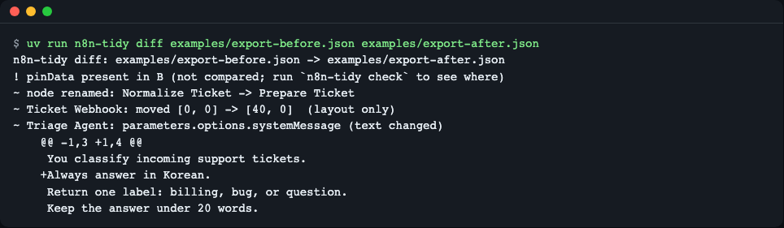
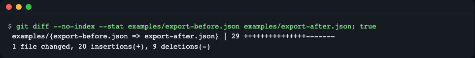
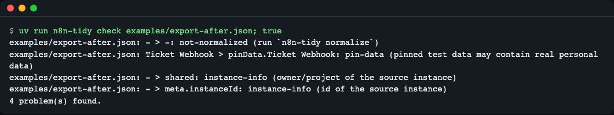
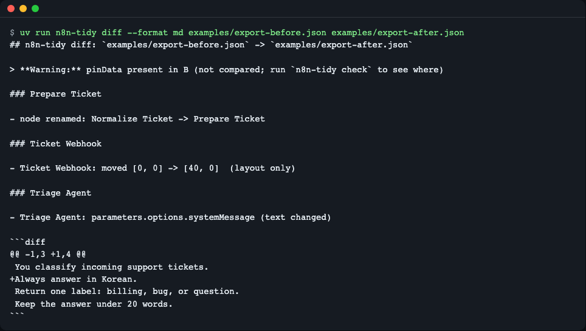
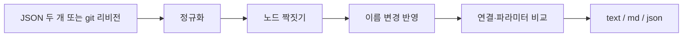

# n8n-tidy

> **English summary** — `n8n-tidy` normalizes exported n8n workflow JSON, shows a semantic diff (renamed nodes, moved nodes, line-by-line AI prompt changes) and checks files before commit, without an n8n instance. It is for people who keep workflow exports in git. Install: `uv tool install git+https://github.com/LeeGyeongPil/n8n-tidy`, then `n8n-tidy diff A.json B.json`.

n8n 워크플로 JSON 을 git 에 넣을 때 생기는 잡음(저장할 때마다 바뀌는 `versionId`·`updatedAt`, 인스턴스 정보, 고정 테스트 데이터)과 "프롬프트 한 줄 바꿨는데 줄 전체가 바뀐" diff 를 정리해 주는 작은 명령줄 도구입니다. n8n 서버도 네트워크도 필요 없고, 런타임 의존성이 없습니다(Python 표준 라이브러리만 사용).


*노드 이름 변경, 위치 이동, 프롬프트 한 줄 추가가 각각 한 줄씩 보입니다.*

노트북 출력을 지워 diff 를 깨끗하게 하는 `nbstripout` 의 n8n 워크플로 판이라고 보면 됩니다.

## 왜 필요한가 — Community 판 백업의 잡음 3가지
1. **저장할 때마다 바뀌는 필드**: `versionId`·`updatedAt` 같은 값이 내용과 무관하게 바뀌어 모든 커밋에 끼어듭니다.
2. **인스턴스 정보와 테스트 데이터**: `shared`·`meta.instanceId`, 그리고 실행에서 고정한 `pinData` 가 들어가 개인정보가 섞일 수 있습니다.
3. **읽기 어려운 변경**: 노드 이름을 바꾸면 연결선이 전부 바뀐 것처럼 보이고, AI 프롬프트는 한 줄 문자열이라 한 줄만 고쳐도 줄 전체가 바뀝니다.

## 이런 분께
- n8n Community 판을 자체 호스팅하며 `n8n export:workflow --backup` 결과를 git 으로 백업하는 분
- AI Agent 노드의 프롬프트를 PR 로 검토하고 싶은 팀
- 고객에게 워크플로 변경 내역을 보여 줘야 하는 분, 실수로 `pinData`(고정 테스트 데이터)나 토큰을 커밋하고 싶지 않은 분

## 설치
```bash
curl -LsSf https://astral.sh/uv/install.sh | sh   # uv 가 없다면 (Python 3.10 이상 필요)
uv tool install git+https://github.com/LeeGyeongPil/n8n-tidy
n8n-tidy --version
```
```
n8n-tidy 0.1.3
```
소스에서 바로 써 보려면 `git clone` 후 폴더 안에서 `uv run n8n-tidy ...` 를 실행합니다. (PyPI 에는 아직 올리지 않았습니다.)

## 빠르게 시작하기
설치 없이 한 번만 실행하려면 `uvx` 를 씁니다(공개 후 사용 가능. 같은 방식을 소스 폴더에서 `uvx --from . n8n-tidy --version` 으로 실행해 `n8n-tidy 0.1.3` 을 확인했습니다).
```bash
uvx --from git+https://github.com/LeeGyeongPil/n8n-tidy n8n-tidy diff A.json B.json
```

저장소의 `examples/` 에 가짜 워크플로 두 개(수정 전·후)가 들어 있습니다. 연습용이며 실제 n8n 에서 받은 데이터가 아닙니다. 예제 파일은 저장소에만 있으므로 먼저 clone 합니다. 아래 명령은 인스턴스 없이 그대로 실행됩니다.
```bash
git clone https://github.com/LeeGyeongPil/n8n-tidy && cd n8n-tidy
n8n-tidy diff examples/export-before.json examples/export-after.json
```
```
n8n-tidy diff: examples/export-before.json -> examples/export-after.json
! pinData present in B (not compared; run `n8n-tidy check` to see where)
~ node renamed: Normalize Ticket -> Prepare Ticket
~ Ticket Webhook: moved [0, 0] -> [40, 0]  (layout only)
~ Triage Agent: parameters.options.systemMessage (text changed)
    @@ -1,3 +1,4 @@
     You classify incoming support tickets.
    +Always answer in Korean.
     Return one label: billing, bug, or question.
     Keep the answer under 20 words.
```
### 의미 diff 읽는 법
- `!` 줄은 경고입니다. 비교하지 않는 `pinData` 가 있다는 뜻입니다.
- `~` 줄이 실제 변경입니다. 이름이 바뀐 노드는 연결선 변경으로 흩어지지 않고 "renamed" 한 줄로 나옵니다.
- `(layout only)` 는 캔버스에서 노드를 옮긴 것뿐이라는 표시입니다(`--no-layout` 으로 숨길 수 있습니다).
- 프롬프트는 바뀐 줄만 보여 줍니다.
- 노드를 짝짓는 방법과 이름 변경 처리 원리는 아래 "동작 원리" 절을 보세요.

같은 두 파일을 그냥 `git diff` 로 보면 이렇습니다.


*휘발 필드와 `shared`·`pinData` 까지 포함해 20줄 추가·9줄 삭제로 보입니다.*

## 사용법
| 명령·옵션 | 하는 일 | 예 |
|---|---|---|
| `normalize PATH...` | 파일·폴더를 안정된 형태로 다시 씁니다(여러 번 실행해도 결과 같음) | `n8n-tidy normalize backups/` |
| `normalize --check` | 아무것도 쓰지 않고, 정리가 필요하면 종료 코드 1 | `n8n-tidy normalize --check backups/` |
| `normalize --stdout` | 결과를 출력만 함(파일 하나) | `n8n-tidy normalize --stdout a.json` |
| `normalize --keep-pin-data` / `--keep-static-data` | 기본으로 지우는 `pinData`·`staticData` 를 남김 | |
| `diff A B` | 두 파일의 의미 diff | `n8n-tidy diff old.json new.json` |
| `diff PATH --rev REV` | git 리비전의 파일과 작업 폴더 비교 | `n8n-tidy diff flow.json --rev HEAD~1` |
| `diff --format text\|md\|json` | 출력 형식(`md` 는 PR 코멘트용) | `--format md` |
| `diff --exit-code` / `--no-layout` / `--color auto|always|never` | 변경 시 종료 코드 1 / 위치 변경 숨김 / 색 사용 여부(값 필수) | |
| `show FILE` | 노드별 블록으로 보는 검토용 보기 | `n8n-tidy show flow.json` |
| `check PATH...` | `pinData`, 정리 안 됨, 인스턴스 정보, 토큰 의심 문자열 검사 | `n8n-tidy check backups/` |
| `check --allow KIND` | 해당 종류를 무시(반복 가능) | `--allow instance-info` |
| `check --keep-static-data` | `normalize --keep-static-data` 로 남긴 `staticData` 를 정상으로 간주(두 명령에 같은 옵션을 짝으로 씁니다) | `n8n-tidy check --keep-static-data backups/` |
| `install-git [--dry-run]` | 이 저장소의 git diff 드라이버 등록 | `n8n-tidy install-git` |
| `uninstall-git` | `install-git` 이 쓴 것을 제거 | |

### 시나리오 1 — 커밋 전에 검사하기
```bash
n8n-tidy check examples/export-after.json
```
```
examples/export-after.json: - > -: not-normalized (run `n8n-tidy normalize`)
examples/export-after.json: Ticket Webhook > pinData.Ticket Webhook: pin-data (pinned test data may contain real personal data)
examples/export-after.json: - > shared: instance-info (owner/project of the source instance)
examples/export-after.json: - > meta.instanceId: instance-info (id of the source instance)
4 problem(s) found.
```
문제가 있으면 종료 코드 1 입니다. `n8n-tidy normalize examples/export-after.json` 을 실행한 뒤 다시 검사하면 `ok: no problems found.` 가 나옵니다.


*네 가지 문제와 종료 코드 1.*

`secret-suspect`(토큰처럼 보이는 문자열) 검사는 정규식으로 짐작하는 방식이라 전문 비밀 스캐너를 대신하지 못합니다. `=` 로 시작하는 표현식 값은 닫힌 `{{ ... }}` 구간을 뺀 나머지를 검사하고, 닫히지 않은 `{{` 는 그대로 검사합니다. 같은 토큰이 여러 패턴에 걸려도 한 번만 보고합니다(`Bearer sk-...` 같은 값도 1건).

### 시나리오 2 — 바로 전 커밋과 비교하기
```bash
n8n-tidy diff backups/ticket.json --rev HEAD
```
커밋된 판과 작업 폴더의 파일을 비교해, 위와 같은 형식으로 보여 줍니다. 저장소 안에서 실행해야 합니다.

### 시나리오 3 — `git diff` 가 읽기 쉬워지게 하기
```bash
n8n-tidy install-git --dry-run
```
```
(dry run) .gitattributes: *.json diff=n8n
(dry run) git config --local diff.n8n.textconv 'n8n-tidy textconv'
(dry run) git config --local diff.n8n.cachetextconv 'true'
(dry run) git config --local difftool.n8n-tidy.cmd 'n8n-tidy diff "$LOCAL" "$REMOTE"'
```
`--dry-run` 을 빼면 실제로 씁니다. 이후 `git diff` 는 JSON 을 노드별 블록으로 바꿔서 비교하므로 순서만 바뀐 것은 덜 보이고, 프롬프트는 줄 단위로 나옵니다. `git difftool -t n8n-tidy` 로 위의 의미 diff 도 볼 수 있습니다. 다만 `git diff`(textconv) 보기는 노드를 이름순으로 늘어놓기 때문에, 이름이 바뀐 노드는 블록의 삭제·추가로 보입니다. "renamed" 한 줄 요약은 `git difftool -t n8n-tidy` 또는 `n8n-tidy diff --rev` 로 보세요. `n8n-tidy` 가 PATH 에 없으면 textconv 가 실패하니 `uv tool install` 로 설치하세요. 설정은 이 저장소의 로컬 git 설정에만 쓰고 전역 설정은 건드리지 않습니다. `.gitattributes` 의 `*.json` 패턴이 넓으면 `--pattern 'workflows/*.json'` 처럼 좁히세요. 워크플로가 아니거나 깨진 JSON 은 원문 그대로 보여 줘서 git 이 실패하지 않습니다.

### 시나리오 4 — PR 코멘트용 마크다운
```bash
n8n-tidy diff --format md examples/export-before.json examples/export-after.json
```
노드별 `###` 절과 프롬프트의 ```` ```diff ```` 블록이 나옵니다.


*PR 본문이나 코멘트에 붙여 넣을 수 있는 형식.*

### pre-commit 연결
`.pre-commit-config.yaml` 에 추가합니다(이 설정은 아직 직접 실행해 확인하지 못했습니다. 훅 정의는 저장소의 `.pre-commit-hooks.yaml` 입니다).
```yaml
repos:
  - repo: https://github.com/LeeGyeongPil/n8n-tidy
    rev: v0.1.3
    hooks:
      - id: n8n-tidy-check
```
`n8n-tidy-normalize` 훅은 파일을 직접 고쳐 씁니다. normalize 훅에 `args: [--keep-static-data]` 를 주면 check 훅에도 같은 args 를 줍니다.

### GitHub Actions 에 끼우기
PR 에서 검사하고, 변경 요약을 Actions 요약 화면에 남기는 예입니다. `fetch-depth: 0` 이 없으면 `origin/main` 같은 리비전을 찾지 못합니다. 코멘트로 게시하는 일은 이 도구가 하지 않으니 필요하면 직접 이어 붙이세요.
```yaml
# .github/workflows/n8n-tidy.yml
name: n8n-tidy
on: pull_request
jobs:
  review:
    runs-on: ubuntu-latest
    steps:
      - uses: actions/checkout@v4
        with:
          fetch-depth: 0
      - uses: astral-sh/setup-uv@v6
      - run: uv tool install git+https://github.com/LeeGyeongPil/n8n-tidy
      - run: n8n-tidy check workflows/
      - run: n8n-tidy diff --rev origin/main workflows/x.json --format md >> "$GITHUB_STEP_SUMMARY"
```
`check` 는 문제가 있으면 종료 코드 1 이라 잡이 실패합니다. 변경이 있을 때 실패시키려면 `diff` 에 `--exit-code` 를 붙입니다. 이 YAML 을 실제 Actions 에서 돌려 보지는 못했습니다. 대신 임시 저장소에서 같은 명령(`check workflows/` → 종료 0, `diff --rev HEAD ... --format md >> 파일` → 종료 0, `--exit-code` → 종료 1)을 실행해 확인했습니다. `--rev` 만 `HEAD` 로 바꿨습니다.

## 정규화 규칙
`normalize` 는 파일을 **제자리에서 고쳐 씁니다.** 폴더 전체에 돌리기 전에 `--check` 나 `--stdout` 으로 먼저 확인하세요. 키는 정렬되고 들여쓰기 2칸, 끝에 줄바꿈 하나로 통일됩니다.

| 필드 | 처리 | 이유 | 관련 옵션 |
|---|---|---|---|
| `updatedAt`, `createdAt`, `versionId`, `activeVersionId`, `versionCounter`, `versionMetadata`, `activeVersion`, `checksum`, `triggerCount`, `isArchived` | 항상 삭제 | 저장·가져오기마다 바뀌고 로직과 무관 | |
| `shared`, `homeProject`, `parentFolder`, `parentFolderId`, `scopes`, `usedCredentials`, `sharedWithProjects` | 항상 삭제 | 원본 인스턴스의 소유자·프로젝트·권한 정보 | |
| `meta.instanceId` | 항상 삭제(`meta` 가 비면 `meta` 도 삭제) | 원본 인스턴스 식별자 | |
| `description`, `nodeGroups`, `sourceWorkflowId` | 비어 있을 때만 삭제 | 새 n8n 이 추가한 필드라 옛 내보내기와 맞추기 위함 | |
| `pinData` | 기본 삭제 | 고정 테스트 데이터에 개인정보가 섞일 수 있음 | `--keep-pin-data` |
| `staticData` | 기본 삭제 | 실행 중 쌓이는 상태 값 | `--keep-static-data` (`check` 에도 같은 옵션) |
| `tags[].createdAt`, `tags[].updatedAt` | 삭제 | 휘발 시각 | |
| `nodes`, `tags` 의 순서 | 이름순으로 정렬 | 순서만 바뀐 변경을 없앰 | |

남기는 것: 워크플로 `id`(다시 가져올 때 필요), 노드 `position`, `credentials` 참조, `connections` 안의 배열 순서, 위에 없는 모르는 최상위 필드. 자격 증명의 비밀 값은 내보내기에 원래 들어 있지 않습니다.

`n8nc fmt` 와 다른 점: `fmt` 는 최상위 키를 7개만 남기는 방식이지만(확인 2026-11-10), `n8n-tidy` 는 위 표의 필드만 지우고 모르는 필드는 그대로 둡니다. 새 n8n 버전의 필드는 `src/n8n_tidy/normalize.py` 맨 위 표 한 곳을 고치면 됩니다.

UTF-8 이 아닌 `.json` 파일은 오류 없이 건너뛰고 `skipped` 로 알려 줍니다.

## 설정
설정 파일과 환경 변수는 없습니다. 기본 동작은 위 "정규화 규칙" 표를 보세요.

### 목 모드와 실제 모드
- **연습용 목(mock) 모드**: 따로 켜는 모드는 아닙니다. 이 도구는 파일만 읽으므로 항상 같은 방식으로 동작하고, 예제 JSON(`examples/`)은 직접 만든 가짜 값입니다. 위의 모든 명령이 이 방식입니다.
- **실제 모드**: `scripts/real-mode.sh` 가 docker 이미지 `n8nio/n8n` 으로 실제 n8n 에서 내보낸 파일에 대해 같은 전제를 확인합니다. 이미지를 받느라 처음에는 수 분이 걸릴 수 있고, 기본 CI 에서는 돌리지 않습니다. docker 와 네트워크가 필요합니다.
```bash
scripts/real-mode.sh
```
기대 출력의 모양(해시 값은 실행마다 다르고, 아래는 형식 설명입니다):
- `e1`, `e2`, `e3` 의 `normalized sha256:` 값이 세 줄 모두 같아야 합니다. 같은 워크플로를 다시 내보내거나 다시 가져와도 정규화하면 같은 바이트가 된다는 뜻입니다.
- `e4` 는 수정 후 파일을 가져와 내보낸 것이라 위 값과 달라야 합니다.
- 마지막 `--- diff e1 -> e4` 아래에 `~` 로 시작하는 의미 변경 줄(노드 이름 변경, 시스템 프롬프트 추가 줄 등)이 나옵니다.

## 동작 원리

- **정규화**: 저장할 때마다 바뀌는 필드와 인스턴스 정보를 지우고 키 순서를 고정합니다.
- **노드 짝짓기**: 노드 `id` 로 먼저 짝을 짓고, id 가 없으면 이름·type 으로 짝을 짓습니다.
- **이름 변경 반영**: n8n 의 연결선은 노드 이름으로 적혀 있어서, 이름이 바뀌면 연결이 전부 바뀐 것처럼 보입니다. 짝지은 결과의 이름 대응표를 옛 연결선에 적용한 뒤 비교해서 이 가짜 변경을 없앱니다.
- **비교**: 연결·파라미터 차이만 모으고, 긴 문자열은 줄 단위 diff 로 보여 줍니다.

## 다른 도구와 비교
확인일 2026-11-10 (GitHub·PyPI 공개 정보 기준).

| | n8n-tidy | n8n 공식 소스 컨트롤 | n8nc |
|---|---|---|---|
| 정규화(휘발 필드 제거) | 있음 | 앱 안에서 처리 | `fmt` 로 잘함 |
| 인라인 시크릿 검사 | 정규식 추정(`check`) | 해당 없음 | `validate` 로 검사 |
| 임의의 두 파일·두 git 리비전 비교 | 있음 | git 연결 후 앱에서 | `n8nc init` 한 저장소의 기준 스냅샷·인스턴스 대비 |
| 프롬프트 줄 단위 diff, git textconv, pre-commit 훅 | 있음 | 시각 diff | 없음(확인한 범위) |
| n8n 인스턴스 연동(내려받기·올리기) | 없음 | 있음 | 있음 |
| 조건 | 파일만 필요 | 유료 플랜 기능 | 설치 필요(Rust 바이너리) |

정규화만 필요하다면 n8nc 의 `fmt` 도 충분합니다. 인스턴스와 동기화까지 하려면 n8nc 나 공식 기능이 맞습니다. 이 도구는 "파일만으로 검토하고 검사하기"에 집중합니다.

`n8n-workflows-comparator` 는 두 백업 파일을 비교하는 도구이지만 휘발 필드 무시와 git 연동이 없고 2025-05 이후 갱신이 멈췄습니다(확인 2026-11-10).

## 한계와 다음 계획
- 배열은 인덱스로 비교해서 노드를 지우면 `[i]` 경로 변경이 여러 건 보일 수 있습니다.
- 토큰 검사는 정규식 휴리스틱입니다.
- 한 파일에 워크플로가 여러 개 들어 있으면 짝이 어긋날 수 있습니다.
- 다음 계획: M2 폴더 단위·리비전 범위 비교, M3 워크플로 하나씩 파일로 나누고 다시 합치기(`split`/`join`).

## 자주 겪는 문제
| 증상 | 원인 | 해결 |
|---|---|---|
| `n8n-tidy: command not found` | uv 의 도구 폴더가 PATH 에 없음 | `uv tool update-shell` 후 새 터미널 |
| `check` 가 계속 `not-normalized` 로 실패 | 정규화 전 파일 | `n8n-tidy normalize PATH` |
| 워크플로가 여러 개 든 파일에서 짝이 어긋남 | 워크플로 짝짓기는 id 순, 그다음 위치 순 | 워크플로 하나씩 파일로 나눠 비교 (파일 이름이 달라도 id 로 짝짓는 폴더 비교는 이후 과제) |
| 노드를 삭제했더니 `[i]` 경로 변경이 여러 건 | 배열 항목이 밀려서 인덱스가 바뀜 | 알려진 한계 |
| `diff --rev` 가 실패 | git 저장소 밖이거나 리비전에 파일이 없음 | 저장소 안에서, 파일 경로를 확인 |
| `--exit-code` 없이 CI 가 통과 | `diff` 는 기본적으로 변경이 있어도 종료 코드 0 | `--exit-code` 를 추가 |
| 표현식(`=...`) 안에 적은 토큰이 `secret-suspect` 로 보고됨 | `{{ }}` 바깥(또는 닫히지 않은 `{{` 뒤)의 문자열도 검사 대상 | 토큰을 지우고 자격 증명(credentials)을 쓰거나 `--allow secret-suspect` |

## 개발·기여
```bash
uv run pytest -q
```
테스트 60개가 n8n·docker·네트워크 없이 돕니다. 버그·제안은 이슈로 남겨 주세요. 변경 기록은 [CHANGELOG.md](CHANGELOG.md).

## 라이선스
MIT. n8n 은 별도 라이선스(Sustainable Use License)이며 이 도구는 n8n 코드를 쓰지 않고 내보낸 JSON 만 다룹니다. 예제 JSON 은 직접 작성했습니다.

참고: n8n 문서 https://docs.n8n.io/source-control-environments/using/compare-changes (확인 2026-11-10).
